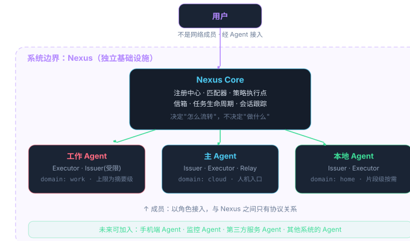
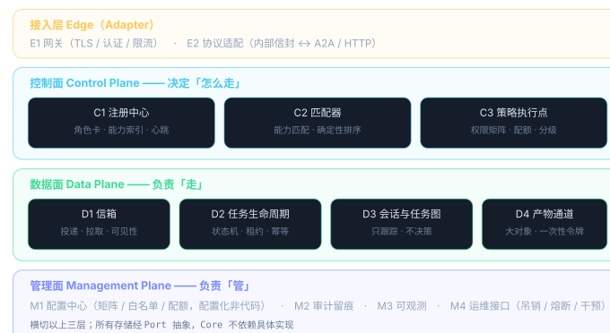
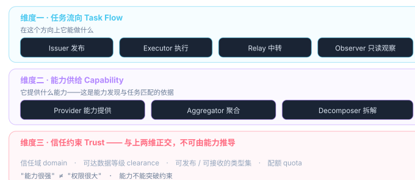
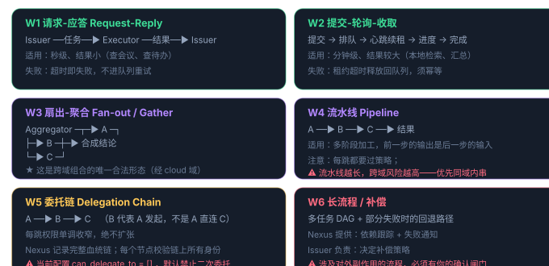
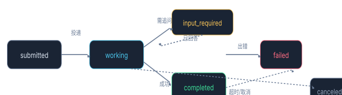

System Definition · v1.2

# Nexus Mesh nxs Agent 协作网络 · 独立基础设施系统定义

一个与任何具体 Agent 都无耦合的协作网络。Agent 以配置好的角色接入，声明自己的能力，按约定的协议模型发布任务或执行任务。**它是独立系统，主 Agent 只是它的一个成员。**

2026-10-07 · v1.2
 系统名 Nexus · 工程名 Nexus Mesh · 代号 nxs
 定位：独立基础设施
 依赖纪律：架构耦合 ≠ 部署依赖 ≠ 配置项

> **命名已定案（见 01 章）：**系统名 **Nexus**，工程名 **Nexus Mesh**，ASCII 代号 **nxs**。本文档已完成全量替换——模块路径用 nxs/*，API 前缀用 /nxs/*，环境变量用 NXS_*，域名用 nxs.example.com。

> **模块编号说明**
>
> 本文档的模块编号已统一为 **M1–M14**（与 `traceability/registry.py`、
> `CONTRIBUTING.md` 一致）。早期版本曾按平面分四套前缀
> （接入层 `E1–E2` / 控制面 `C1–C3` / 数据面 `D1–D4` / 管理面 `M1–M4`），
> 因与其他编号体系撞号而合并。对照见 `CONTRIBUTING.md`「已废弃的字母」。
>
> **各模块的实现状态不写在这里。** 状态会变，写两处必然不一致。
> 唯一权威是 [`traceability/registry.py`](../../traceability/registry.py)，
> 人可读的视图是 [`docs/architecture.md`](../architecture.md) 的模块表 ——
> 两者由 `tests/test_docs_consistency.py` 守护一致性。
> 本文只负责"这个系统应该是什么样"。
>
> **本文档只列了 13 个模块**（M1–M9、M11–M14），缺 **M10 应答边界** ——
> 这不是遗漏：`M10` 是在后续的需求审查中发现并补入的，当时的模块列表里
> 没有单列它（其职责散落在别处）。补入的理由见
> [`03-traceability-review.md`](03-traceability-review.md) 与
> [`docs/architecture.md`](../architecture.md)。

## 00 一句话定位

> **本文定义的这个系统是一个独立的 Agent 协作基础设施。**

它提供四件事：**让 Agent 注册自己的能力**、**让 Agent 被别人发现**、**让任务被投递与执行**、**让每一次协作都可校验可追溯**。

它**不**决定任何业务：不决定谁该做什么，不决定任务怎么拆，不决定结果怎么用。**这些决策权属于接入的 Agent。**

它与主 Agent 的关系，等同于它与任何一个 Agent 的关系——**都是"接入方"**。

### 0.1 三个概念要先分清

| 概念 | 是什么 | 类比 | 与 Nexus 的关系 |
|---|---|---|---|
| **本体 Nexus** | 通信与协作的基础设施系统 | 一个给 Agent 用的 IM 软件<br>（见 0.2） | **本体**。独立部署、独立演进、可整体搬迁。**它与主 Agent 的关系，等同于它与任何 Agent 的关系** |
| **Agent** | 具备能力、能发布或执行任务的实体 | 寄信人 / 收信人 / 话务员 | **成员**。以角色接入，与 Nexus 之间只有协议关系 |
| **用户** | 最终的需求提出者与决策者 | 寄信人本人 | **不是成员**。人通过某个 Agent（当前是主 Agent）与网络交互 |

> **一个必须写清的设计约束：**"人不是成员"这一点很重要。Nexus 的成员集合里永远只有 Agent，不直接有"用户"。
这样设计的好处是：**将来换一个人机入口（从 IM 渠道 换到别的渠道、或者换一个主 Agent 实现），Nexus 完全不需要改动**——只是"接入方"换了一个。

### 0.2 这个系统像什么 帮你快速建立直觉

> **你的说法很准确，我把它作为正式定位写进来：Nexus 就像给 Agent 用的一个「IM 软件」，或者说一个「协作网络」。**

说"像 IM"，是因为它具备 IM 的全部基础要素：

> - **身份与账号** —— 每个成员有唯一 ID（member_id）
> - **在线状态** —— 心跳维持，别人能看到你活着没有
> - **联系人列表** —— 就是注册表：有谁在、各自擅长什么
> - **一对一消息** —— Direct 模式的任务投递
> - **群聊** —— 扇出模式：一个需求同时问多个成员
> - **消息记录** —— 审计留痕
> - **已读 / 未读** —— 任务状态（submitted → working → completed）

> **但它比 IM 多了四样东西——这四样才是它作为"协作网络"而非"聊天工具"的关键：**

> | 多出来的 | IM | Nexus |
> |---|---|---|
> | **消息是结构化的** | 自由文本，人自己理解 | **带类型与参数 schema 的任务**，机器可校验、可路由 |
> | **有生命周期** | 发出就完了 | **有状态机**：投递、执行、追问、超时、重试、幂等 |
> | **有权限矩阵** | 谁能跟谁说话基本不管 | **默认拒绝**：跨域委托需显式授权，应答有等级上限 |
> | **有能力发现** | 你得知道找谁 | **按能力匹配**：只说"需要什么能力"，不用知道拓扑 |

> **一句话概括：它是一个"有规则、可审计、会路由的 IM"。**

## 01命名 已定案

Nexus工程名：Nexus Mesh已定案

**系统名：Nexus工程名 / 项目名：Nexus MeshASCII 代号：**nxs

 **命名层次（三者用途不同，不要混用）：**

| 层次 | 用法 | 出现位置 |
|---|---|---|
| **系统名** Nexus | 日常指称这个系统 | 对话、文档、运维沟通 |
| **工程名** Nexus Mesh | 项目仓库名、部署单元名 | 代码仓库、容器镜像、部署清单 |
| **代号** nxs | **短标识**，进入所有技术标识符 | 代码包名、配置键、环境变量前缀、域名、模块路径 |

**具体落法：**域名 nxs.example.com　·　环境变量 NXS_*　·　模块路径 nxs/edge/gateway　·　API 前缀 /nxs/*

### 1.1 为什么最终是 Nexus—— 你的论证比我原来的更准确

> **我在 v1.1 里说"Nexus 隐含中心，与 Mesh 有语义张力"。你指出这个判断反了："Nexus 虽然有核心的意思，但恰恰这个协作网络本身就是中心。"你说得对，而且这比我原来的分析更准确。**我犯了两个错：

> - **把"物理事实"当成了"架构缺陷"。**Nexus Mesh 在**物理拓扑上确实是一个汇聚点**——所有成员都连向它。这不是需要回避的，而是需要准确描述的。我却把它当成"名字与架构不符"的证据。
> - **过度追求"去中心"这个词。**Mesh 的实质是**语义对等**（谁都能发布、谁都能执行、能力可被发现），**不是"物理上没有汇聚点"**。这两件事我们前面已经区分过一轮了（见 2.1），我却在起名时又混了一次。

> **Nexus 精确描述了这个系统的双重性质，这是"经纬"做不到的：**

> | 层面 | Nexus 的表达 | 经纬的表达 |
> |---|---|---|
> | **物理拓扑**<br>（成员都连向它） | ✅ 精确命中 —— **Nexus 就是"连接枢纽"** | ❌ 缺失这一层 |
> | **语义网络**<br>（成员之间对等协作） | ✅ 「Mesh」补齐 —— 系统名 + 工程名合起来正好是"枢纽 + 网络" | ✅ 命中 |
> | **思想连接**<br>（你提到的这一点） | ✅ **Nexus 的词源 nectere 即"绑、联结"，在英文中常指"事物之间的联系与关联"**——不只是物理连接，更是**关系与思想的连接**，这正是 Agent 互联要说的事 | △ 「经纬」偏空间与秩序，没有"连接"的动词性 |

> **所以 Nexus Mesh 这个组合反而是最完整的：Nexus 说明了"这里有一个汇聚点且它承载连接"，Mesh 说明了"成员之间是对等网络关系"。**两层意思都在名字里，而且是分开表达的，不会互相干扰。

### 1.2 为什么没有选其他候选

保留这份记录，因为将来若有人问"为什么不叫 XX"，这里就是答案。也避免重复讨论。

| 候选 | 当初的吸引力 | 落选原因 |
|---|---|---|
| **经纬**<br>Lattice | "本身就是一张网"；《周礼》「九经九纬」＝古代道路网；引申义"组织、条理"恰好是基础设施职责 | **认知成本太高（你的判断）**。作为技术系统名，"经纬"需要额外解释才能被理解；而 "Lattice" 在英文里也被密码学（格密码）与材料学占用，有歧义。**名字的首要功能是被理解，不是被欣赏** |
| **经络**<br>Meridian | 连通全身、无单一中心；「通则不痛」的运维隐喻很好用 | 重心偏"连通与流转"（像管道），缺"交织成网"义；且在中文里较强绑定中医语境，作为技术名会有无关联想 |
| **驿**<br>Relay | 古代邮驿系统：驿是节点、驿路是链路、驿传制度是协议——三层同构 | 偏"传递"，对"协作"表达弱；单字作系统名略单薄。而且 "Relay" 与角色名 Relay 冲突 |
| **通衢**<br>Confluence | 各方交汇、往来无阻 | 偏"路"不偏"网"，无"交织"意象；单字「衢」生僻 |
| **同声**<br>Resonance | 《易》「同声相应，同气相求」——Agent 互相发现的古典表述 | 隐含"一致"，而 Mesh 里各成员恰恰是不同的（各有专长），有轻微误导 |

### 1.3 命名纪律（写进工程规范）

> **三条，按重要性排序：**

> 2. **nxs 一旦使用就不再更改。**它会出现在代码包名、配置键、环境变量、域名、部署脚本里。**改名成本随时间指数上升**——所以中英文名将来若想调整，代号 nxs 也不动。
> 4. **三个层次不要混用。**不要出现"nxs 系统"这种表述（应说"Nexus"）；也不要在文档里写环境变量时用全称（应说 NXS_*）。**约定：面向人与面向机器，用不同的名字。**
> 6. **文档正文统一使用 Nexus。**本文档已完成全量替换，「经络」「Meridian」「经纬」等候选名只保留在 1.2 节的历史记录与修订记录里（那是讨论留痕，不应删除）。

## 02为什么必须把它独立出来

你的判断是对的。这一节我把"独立"带来的收益写清楚，同时诚实地指出**哪些地方它仍然和主 Agent 有关系**——因为完全解耦在这个场景里既不可能也不必要。

### 2.1 独立的四项收益

#### ① 可迁移

性能容量不够时，迁到别的服务器只是**重新部署 + 改配置**。**前提是它不绑定任何具体 Agent**——迁完之后各成员重新连入即可，成员侧通常什么都不用改。（注意：依赖库、数据库驱动这些属于部署依赖，是正常情况，不影响迁移。详见 06.1）

#### ② 可替换

主 Agent 从 Agent 实现 A 换成别的实现，或者换一个不同的 Agent 做人机入口，**Nexus 不需要改动**。因为对它来说那只是"某个成员换了"。

#### ③ 可独立演进

路由策略、角色模型、配额机制的迭代，不影响任何 Agent 的业务逻辑；反之 Agent 升级也不影响 Nexus。**两边的发布节奏解耦。**

#### ④ 边界清晰可审计

所有跨 Agent 的协作都发生在一个明确的系统里。**要审计"谁在什么时候让谁做了什么"，只需要看这一个系统的日志。**

### 2.2 但要诚实指出：三处"仍然有关系"

> **解耦的是"架构"，不是"权限"。**下面三件事在**当前**状态下仍然特殊，但我坚持它们应该由**角色配置**表达，而不是由**架构特例**表达——这才是真正解耦的意义。

| 特殊之处 | 为什么现在特殊 | 怎么表达（关键） |
|---|---|---|
| **它是唯一人机入口** | 你只通过 IM 渠道 与主 Agent 交互，所以所有需求都从它进入网络 | 由角色卡的 roles.human_interface = true 表达。**将来若要加第二个入口（如手机端），只需多配一个成员，不改架构。** |
| **它是唯一跨域聚合点** | 只有它有"跨域合成"这个能力，所以跨域行为都经它 | 由能力声明 capability: cross-domain.aggregate + 权限矩阵表达。**如果将来某个 Agent 也具备这个能力，它也能成为聚合点——这是配置变更，不是架构变更。** |
| **它托管了 Nexus** | 当前 Nexus 与主 Agent 跑在同一台云服务器上 | 这纯粹是**部署巧合**，不是架构关系。**10.1 的部署演进路径就是为了让这一点变得随时可改。** |

> **这就是"独立系统"这个提法的真正价值。**不是"物理上分开"，而是**"在概念与依赖上分开"**——当将来你想换人机入口、想加聚合点、想把 Nexus 搬走，都只是配置或运维动作，而不是架构决策。

反之，如果继续把它当"主 Agent 的一个功能"，那么上面三件事会被写死在代码里，将来每一次变更都要动手术。

## 03系统边界



图 1 · 系统边界。**紫色虚线内是 Nexus 的职责范围**——它只负责让成员之间能互相发现与委托，不负责任何业务决策

### 3.1 它是（In Scope）

#### 身份与注册

维护成员的身份、角色卡、能力声明、存活状态。**是"谁知道有谁存在、谁有什么本事"的唯一权威。**

#### 发现与匹配

根据任务需要的能力，匹配出满足约束的候选执行者。让发布方**不需要知道拓扑**。

#### 投递与生命周期

把任务放到正确的信箱；跟踪状态流转；处理租约、超时、重试、幂等。

#### 策略与约束执行

按权限矩阵校验"这次委托是否被允许"；配额限流；数据分级约束。

#### 可追溯

每次协作的全链路留痕：谁、何时、向谁、发了什么类型的任务、命中了哪条规则、结果等级是什么。

#### 会话容器

为一次用户诉求（可能包含多个任务）提供统一的上下文标识，便于追溯、配额统计、授权复用。

### 3.2 它不是（Out of Scope）

> **这一节比 3.1 更重要。**边界画得清不清，主要看"明确排除了什么"。

| 不做 | 为什么不做 / 该由谁做 |
|---|---|
| **不决定业务逻辑** | 什么任务该拆成什么子任务、结果怎么解读——这是 **Issuer / Decomposer 角色**的职责，属于 Agent |
| **不做 LLM 调用** | Nexus 是纯基础设施，**不含任何模型推理**。它不理解任务内容，只做类型与字段层面的校验 |
| **不做数据出境/应答范围的决策** | 那是**应答边界**的职责，装在 Agent 侧。Nexus 只校验"声明的等级"是否符合权限矩阵，**不检查内容真实性** |
| **不存业务数据** | 只存元数据（任务信封、状态、审计）。**不存 Agent 的原始数据、不存会话正文** |
| **不直接面向人** | 没有面向人的 UI。**人通过某个 Agent 接入**，Nexus 的成员集合里只有 Agent |
| **不保证业务正确性** | 只保证"投递到、不重复、可追溯"。**任务做没做对是 Agent 的事** |
| **不解决 Agent 自身被攻破** | 那是各 Agent 宿主环境的安全边界。**Nexus 只负责"这一条协作路径"上的约束** |

## 04架构分层：三个平面

采用网络架构的标准三分法——**控制面 / 数据面 / 管理面**。这个划分的价值在于：它明确了"哪些模块决定怎么走"、"哪些模块负责走"、"哪些模块负责管"，三者的演进节奏与失败模式都不同。



图 2 · 三平面架构。注意管理面是**横切**的——它不参与运行时的任务流转，但决定流转的规则并对流转做记录

### 4.1 为什么这样分

| 平面 | 回答的问题 | 失败模式 | 演进节奏 |
|---|---|---|---|
| **控制面** | "这个任务该由谁执行"、"这次委托允许吗" | 匹配错误 → 任务去了不该去的地方；策略失效 → 越权 | 随策略与业务变化，**改得最多** |
| **数据面** | "任务怎么送到、状态怎么记" | 丢任务、重复执行、永久卡死 | 相对稳定，**改得最少但要求最稳** |
| **管理面** | "规则是什么、发生了什么、怎么干预" | 规则漂移无人察觉；出事无法追溯 | 随治理需求增长，**需要定期 review** |

## 05模块划分

每个模块按**职责 / 输入 / 输出 / 依赖**四要素定义。**依赖方向严格单向**：接入层 → 控制面 → 数据面 → Port。任何反向依赖都是设计错误。

### 5.1 接入层 Edge（Adapter 层）

M1 网关 Gateway`nxs/edge/gateway`

职责：所有流量的唯一入口。TLS 终止、成员双向认证、请求签名校验（含时间戳 + nonce 防重放）、速率限制、请求体大小限制。
 输入：来自成员的 HTTPS 请求
 输出：已认证的请求 → 路由到内部模块
 依赖：无（最底层，只依赖标准库与 TLS）
 关键约束：**网关不做业务判断**。它只回答"你是谁、你有没有超速、这个包能不能收"，不回答"你能不能做这件事"——后者是 M5 的职责。

M2 协议适配 Protocol Adapter`nxs/edge/proto`

职责：把外部协议翻译成内部统一信封，反之亦然。当前只有一种内部信封；适配器负责未来对接 A2A 或其他协议。
 输入：外部协议报文（未来：A2A JSON-RPC / 其他）
 输出：内部信封 Envelope
 依赖：无（纯转换）
 关键约束：**这是"不实现 A2A 栈"与"将来能接 A2A"之间的那道门。**内部 Core 永远不感知外部协议的存在——这是 Adapter 模式的教科书用法。

### 5.2 控制面 Control Plane（Core 的一部分）

M3 注册中心 Registry`nxs/control/registry`

职责：成员身份与能力的唯一权威。维护角色卡（角色 / 能力 / 约束）、心跳与存活状态、卡片版本。
 输入：注册请求、心跳、卡片更新
 输出：按能力查询的候选成员列表（供 M4 使用）
 依赖：Port: Registry Store
 关键约束：

- **注册需要人工批准**——新成员不能自己加入。这是"已知少数节点"原则的落实。
- 存活状态分三档：alive / stale（超过心跳阈值，不参与路由但保留历史）/ revoked（已吊销）。**stale 不删除，因为需要追溯**。
- 卡片变更需要版本号递增，历史版本保留（便于回答"当时它是怎么声明的"）。

M4 匹配器 Matcher`nxs/control/matcher`

职责：根据任务所需能力，从注册中心筛出满足条件的候选执行者，并按**确定性规则**排序。
 输入：能力需求（require）+ 上下文（来源域、数据等级、Session）
 输出：有序候选列表
 依赖：M3、M5（匹配结果需先过策略校验）
 关键约束：

- **排序必须确定性。**多个候选时按固定优先级（如：同域优先 → 信任等级 → 当前负载 → 节点 ID 字典序）。**随机选择会导致行为不可复现，调试极痛苦。**
- 匹配只看"能力 + 约束"，**不看"关系"**。这是 Mesh 语义与 Hub 语义的分界点。

M5 策略执行点 PEP`nxs/control/policy`

职责：回答"这次委托允许吗"。校验权限矩阵、配额、数据等级、任务类型白名单。
 输入：（发布方, 执行方, 任务类型, 请求等级, Session 上下文）
 输出：允许 / 拒绝 / 降级（附带命中的规则 ID）
 依赖：M11 配置中心
 关键约束：

- **默认拒绝。**没有显式允许的规则即拒绝。
- **拒绝时不泄露细节。**只返回 rule_id，不返回被拒内容或原因细节——**错误信息本身也是信道**。
- 这是**所有安全策略的唯一执行点**。任何绕过它的路径都是设计缺陷。

### 5.3 数据面 Data Plane（Core 的一部分）

M6 信箱 Mailbox`nxs/data/mailbox`

职责：为每个成员维护待办队列，提供投递与拉取。
 输入：已通过策略校验的任务 → 投递；成员轮询 → 拉取
 输出：任务列表（拉取即打租约）
 依赖：Port: Queue Store
 关键约束：

- **拉取即加锁。**同一任务不能被两个实例同时取走。
- 空队列返回 204（省流量）；**不做长轮询**（企业网络会切 idle 连接）。
- Queue 必须持久化——**这是"迁到别的服务器只是重新部署"的前提之一**。

M7 任务生命周期 Task Lifecycle`nxs/data/task`

职责：维护任务状态机，管理租约、超时、重试、幂等。
 输入：状态变更请求（ack / progress / result / fail）
 输出：新的任务状态
 依赖：Port: Queue Store
 关键约束：

- **断电恢复零人工干预**：租约超时自动释放 + 最多重试 N 次 + 最终标记 failed 并通知。
- **幂等键（idempotency key）是必填字段**，由 Issuer 生成。重试不能产生重复副作用。
- 状态流转不可跳跃、不可回退（除了 input_required ↔ working）。

M8 会话与任务图 Session & Task Graph`nxs/data/task.py:session_view`

职责：为一次用户诉求提供统一上下文标识，跟踪该诉求下所有任务的依赖关系与推进状态。
 输入：Session 创建 / 任务加入 / 依赖声明
 输出：Session 视图（含各子任务状态、依赖是否满足）
 依赖：M7
 关键约束：

- **这是最容易越界的一个模块。**必须反复强调：**它只"跟踪"任务图，不"决定"任务图。**
- 怎么拆、拆几个、发给谁——由 Issuer / Decomposer 角色（即 Agent）决定，Nexus 只负责记录"它声明了这样的依赖关系"，并在依赖满足时通知。**一旦 Nexus 开始"决定"怎么拆，它就退回了 Hub 模式。**
- Session 是**配额统计与授权复用**的天然边界（见 8.4）。

M9 产物通道 Artifact Channel`nxs/core/models.py`（kind）· 存储约定

职责：承接超过信封承载能力的产物（大文档、代码库检索结果集等）。
 输入：产物提交（产出方）/ 一次性令牌兑换（消费方）
 输出：产物流（或引用坐标）
 依赖：Port: Artifact Store
 关键约束：

- **默认走"引用传递"而非"内容传递"**：信封里放坐标（如 文件存储路径 / 本地存储相对路径 / 对象存储 key），需要时再由消费方按自己的策略去取。**这符合"把计算移到数据旁"的原则。**
- 大产物的直取需要**一次性令牌**，限定单个 artifact、单次使用、短有效期。
- 产物通道只负责搬运，**不检查内容**——内容是应答边界的责任。

### 5.4 管理面 Management Plane

M11 配置中心 Config Store`nxs/mgmt/config`

职责：承载所有可配置的策略：权限矩阵、任务类型注册表、字段白名单、配额、成员名单。
 关键约束：配置化而非代码化（这是"能力漂移"的对策）。**任何配置变更都留版本与变更时间戳**，支持"当时是什么规则"的回溯。变更需一次显式确认。

M12 审计留痕 Audit Trail`nxs/mgmt/audit`

职责：记录每一次协作：时间、Session、任务 ID、类型、发布方、执行方、命中规则、应答等级、字节数、结果状态。
 关键约束：

- **只记元数据，不记业务内容**（否则 Nexus 自己就成了数据集中点）。
- 审计日志**写入失败时熔断**——"不可追溯的协作"比"中断"更糟。
- 日志按保留期分层：热数据（近期，可查询）与冷归档。

M13 可观测 Observability`nxs/mgmt/observ.py`

职责：指标、链路追踪、告警。
 关键指标：

- **Quest 侧**：任务提交率、完成率、延迟 p50/p95/p99、按类型的失败率
- **成员侧**：卡片新鲜度（stale 数量）、心跳缺失、背压水位
- **策略侧**：拒绝率、拒绝原因分布（突增往往意味着配置错误或攻击）
- **系统级关联**：跨成员的模式异常（如"某成员同时出现大响应 + 高频请求"）——单看每个指标都正常，组合起来才可疑

关键约束：告警要建在**系统级关联**上，不只是单成员级。

M14 运维接口 Ops API`nxs/edge/gateway.py`（ops 端点）· `OpsClient`

职责：人工干预入口：吊销节点、清空队列、熔断某条链路、强制释放租约、暂停某类型任务。
 **当前已实现**：批准、吊销、释放租约、查节点、读指标。
 **尚未实现**：清空队列、熔断链路、暂停某类型任务 —— 这三项目前仍需改配置重启。
 关键约束：所有操作需鉴权 + 留痕。**这是"出事时能快速止血"的那条路径，必须存在且必须好用**——没有它，出问题时只能改代码重启。

### 5.5 Port 抽象层

| Port | 抽象的能力 | 候选 Backend |
|---|---|---|
| QueueStore | 持久化队列、原子取任务、租约、状态更新 | SQLite（单机足够）→ Postgres / Redis + 持久化 |
| RegistryStore | 角色卡存储、能力索引、心跳时间戳 | SQLite → Postgres |
| AuditStore | 审计记录写入与查询、保留期管理 | 本地文件（NDJSON）→ 对象存储 / 日志系统 |
| ArtifactStore | 大产物暂存、一次性令牌 | 本地磁盘 → 对象存储；或**只存引用不存内容** |
| Notifier | 向外发出提醒（可选：告警、给人工接口的推送） | 控制台 / 企业微信 / IM 渠道 通道 |

> **Port 抽象的价值是「可替换性」与「可测试性」，不是「可迁移性」。它带来两个实实在在的好处：**

> - **可替换**：将来从 SQLite 换到 Postgres、从本地磁盘换到对象存储，**只改 Backend 实现与配置，Core 一行不动**
> - **可测试**：可以用内存实现跑完整的单元测试，不需要起数据库。**这是 Port 抽象在日常开发中收益最大的地方**

> **⚠ 修正 v1.0 的一处错误论证。**

v1.0 里我写了"Core 里出现一行 import sqlite3，可迁移性就当场归零"。**这个推论混淆了两个不同的层次，是错的：**

> - Core 通过 Port 抽象、不感知具体存储实现 —— **这是为了可替换与可测试（见上）**
> - 而 Backend 实现层**当然要 import 数据库驱动** —— 这是**部署依赖**，完全正常

> **更根本的错误在于：我用"迁移"去论证"不要依赖具体存储"，但这两件事没有因果关系。**恰恰相反——**SQLite 单文件、拷贝即迁移，是所有存储里最便于迁移的一种**。用"迁移便利性"来论证"避免 SQLite"在逻辑上是自相矛盾的。

**完整的教训记在 06.1 节：架构耦合 ≠ 部署依赖 ≠ 配置项，三者必须分开对待。**

## 06与架构铁律的映射

你的铁律是 Adapter → Core → Port ← Backend。Nexus 作为独立系统，同样遵守：

| 层 | Nexus 里的对应 | 纪律 |
|---|---|---|
| **Adapter** | M1 网关、M2 协议适配 | 负责"与外界说话"。**Core 不知道外界用的是 A2A 还是别的协议。** |
| **Core** | 控制面 M3–M5 + 数据面 M6–M9 | **不感知宿主、不感知存储实现。**纯逻辑，可用内存实现跑测试。不 import 任何 Agent 框架；不 import 任何数据库驱动（驱动在 Backend 层）。 |
| **Port** | QueueStore / RegistryStore / AuditStore / ArtifactStore / Notifier | 只定义接口与数据契约，**不定义实现**。价值是**可替换与可测试**（见 06.1）。 |
| **Backend** | SQLite / Postgres / 本地文件 / 对象存储 | 可替换。换 Backend 不改 Core 一行代码。**驱动依赖（如 sqlite3）出现在这一层，完全正常。** |

### 6.1 三类"依赖"必须分开对待 v1.1 新增 · 修正一处错误论证

这是本次修订的核心。v1.0 里我把三种性质完全不同的东西混在了一起，导致推出了错误结论。分开之后，纪律变得清晰且可执行。

| 类别 | 具体是什么 | 是否允许 | 为什么 |
|---|---|---|---|
| **① 架构耦合** | · 依赖主 Agent 的实现<br>· 依赖某个具体 Agent 的存在<br>· 代码里硬编码成员名字 / 域名 / 特定类型的特判 | 禁止 | **它破坏的正是"独立系统"这个定位。**一旦存在，迁移就必须改代码，加成员也必须改代码——基础设施就退化成主 Agent 的一个模块 |
| **② 部署依赖** | · 第三方库<br>· 数据库驱动（sqlite3 / psycopg）<br>· Web 框架、运行时、操作系统 | 允许 | **这是"系统自身实现方式带来的约束"，属于正常情况。**任何软件都有部署依赖，换环境时按依赖清单重新装即可。**把它当问题就等于说"这系统不该被实现"** |
| **③ 配置项** | · IP 地址、域名、端口<br>· 凭据、密钥<br>· 策略、配额、成员名单 | 允许 | 只要**出现在配置里而非硬编码在代码里**就没问题。**IP 写在配置文件里，与"架构耦合"毫无关系**——迁移时改一行配置即可 |

> **于是"可迁移"的正确论证变得非常简洁：可迁移 = 独立服务（无①类耦合）+ 配置外部化（③类放在配置里）②类部署依赖不影响迁移**——迁移时把依赖一起装过去就是了。
这比 v1.0 的论证干净得多，因为它不再需要"Core 不能有任何具体依赖"这种过强的、也不可能完全满足的条件。**而且它直接对应你说的那句话：迁移时所有 Agent 只需要重新连入就行。**

> **顺带修正 10.1 节的一项表述。**v1.0 我把"存储可导出导入"列为迁移的**技术前提**，还写了"不要用只能原地升级的存储格式"。**这条定位过高了：**

> - 任何存储都有迁移方法（SQLite 拷文件、Postgres dump/restore、对象存储 rsync）——**它是"迁移流程的一个步骤"，不是"系统必须满足的设计前提"**
> - 真正值得保留的建议只有一句：**迁移前先验证一次完整的数据导出与恢复**，因为没演练过的备份等于没有备份
> - 至于"用哪种存储"——**按容量、运维成本、团队熟悉度选就好，不该由"迁移便利性"主导**（何况论迁移便利，单文件 SQLite 反而是最强的）

> **一条我认为值得单独立规矩的边界：Nexus 的代码库里，不允许出现任何 Agent 的名字。**

意思是：不该有 if node == "work-agent"、不该有 if domain == "work" && type.startswith("query.calendar") 这类硬编码。**所有这类判断都必须来自 M11 配置中心的数据。**

这不是洁癖，而是这个系统能不能被称为"独立基础设施"的判据：**如果加一个成员需要改 Nexus 的代码，那它就不是基础设施，而是主 Agent 的一部分。**

## 07角色模型

角色是 Agent 接入 Nexus 时声明的东西。它由三个正交维度构成——**前两维回答"能做什么"，第三维回答"允许碰什么"**，两者不可互相推导。

### 7.1 三个维度



图 3 · 三维角色模型。v1.3 相比新增了 **Observer（只读观察者）** 角色——为将来的监控 Agent 预留

### 7.2 各角色的语义定义

| 角色 | 语义 | 对 Nexus 的要求 | 典型用途 |
|---|---|---|---|
| **Issuer**<br>发布 | 能把需求拆成任务并投递到网络；可以是任务的来源，也可以是任务链中的一环 | 需要 can_issue_types 白名单；**配额按"发布"维度计** | 主 Agent（人机入口）、本地 Agent（自主发现需补充能力时） |
| **Executor**<br>执行 | 能接收任务、执行、回传结果（含 input_required 追问） | 需要能力声明 + can_receive_from + 应答等级上限 | 所有节点。这是最普遍的角色 |
| **Relay**<br>中转 | 不执行业务，只做转发。**在当前部署里这个角色由 Nexus 自身承担**，所以没有成员需要它 | 需要 relay_targets 白名单 | 预留：将来若做多总线联邦、或某节点需为另一域代收任务 |
| **Observer**<br>只读 | 只能读取元数据（任务状态、注册表、指标），**不能发布也不能执行** | 只读权限；看不到业务内容（Nexus 本来就不存） | 预留：监控 Agent、审计 Agent、看板 |

> **关于 Relay 多说一句：**在 v1.3 的设计里，Hub 承担了"中转"这个角色。但按现在的定位，**中转是 Nexus 自身的能力，不是某个成员的角色**。所以 Relay 在当前配置里是空的——保留它是为了两种将来的场景：① 多总线联邦（一个总线把任务转给另一个总线）；② 某节点在特定网络分区内为其他节点代收任务。

### 7.3 角色卡（Role Card）

成员接入时提交的声明。它是 A2A Agent Card 的对应物，但**显式增加了"信任约束"这一维**——因为 A2A 假设参与方是对等的跨组织伙伴，而这里三个成员的信任等级根本不同。

```
// Nexus 角色卡 · 成员身份与能力的唯一权威声明
{
  "card_version": "1.0.0",              // 卡片自身格式版本
  "member_id": "work-agent",
  "display_name": "工作 Agent",
  "domain": "work",                      // 信任域：work | home | cloud
  "reachability": "egress-only",        // 仅主动出站（当前所有节点都是）
  "heartbeat_interval": 60,              // 秒；超过 3 倍视为 stale

  // —— 维度一：任务流向
  "roles": {
    "issuer":   true,                   // 能力上可以，但受下面 can_issue_types 限制
    "executor": true,
    "relay":    false,
    "observer": false,
    "human_interface": false          // ★ 是否为人机入口（当前仅主 Agent 为 true）
  },

  // —— 维度二：能力供给
  "capabilities": [
    { "type": "query.calendar",          "level": "summary", "mode": "sync",
      "params_schema": { "date": "date", "scope": "mine|all" },
      "response_fields": ["time", "topic", "attendee_count"] },   // ★ 字段白名单

    { "type": "query.interview_status",   "level": "summary", "mode": "sync",
      "params_schema": { "candidate": "string" },
      "response_fields": ["stage", "scheduled_at"] },

    { "type": "summarize.todo",           "level": "summary", "mode": "async",
      "params_schema": { "range": "today|week" },
      "response_fields": ["items", "freetext_summary"] }        // ★ 含自由文本字段，需标注
  ],

  // —— 维度三：信任约束（★ 独立于能力）
  "constraints": {
    "max_response_level": "summary",            // 硬上限：片段级 / 原文级 在实现层不存在路径
    "can_issue_types": [],                // ★ 空数组 = 作为 Issuer 时不可发布任何类型（Q9 待定）
    "can_receive_from": ["cloud"],        // 谁可以给它派任务
    "can_delegate_to": [],                // 不做二次委托
    "quota": {
      "tasks_per_day": 200,
      "bytes_per_response": 65536,
      "bytes_per_day": 4194304,
      "concurrent_tasks": 1            // 单并发：工作机资源有限
    }
  }
}
```

> **卡片里两处最关键的字段，实现时不要省：① response_fields——字段白名单写在卡片里。**这意味着"这个任务类型能返回哪些字段"是**成员注册时声明的**，而不是运行时判断的。这让 片段级 / 原文级 的不可达成为**结构事实**而非运行时判断。

**② can_issue_types: []——Issuer 能力的实际开关。**roles.issuer = true 只是"能力上可以"，真正的权限由这个白名单决定。当前为空，意味着 Work 不能发布任何任务。**这是 Q9 待你决策的那个点。**

### 7.4 复杂度控制：用角色代替点对点授权

Mesh 化的一个真实代价：权限关系可能从 O(N) 膨胀到 O(N²)。

| 模型 | 规则形态 | 规则数量 |
|---|---|---|
| **逐对授权**<br>不采用 | "A 能不能问 B" —— 每个有向对一条规则 | 3 节点 6 条；6 节点 30 条；10 节点 90 条 |
| **基于角色**<br>采用 | "X 角色的成员可发布哪些类型"+"这些类型需什么能力与约束" —— 规则绑定在类型与角色上 | **与成员数无关**，只与任务类型数相关 |

> **所以 Nexus 的权限模型必须是：矩阵的维度是「域 × 类型」，不是「成员 × 成员」。**

· **域**只有三个（work / home / cloud），将来新增成员一般归属既有域

· **类型**是有限枚举（当前 3–4 个，未来几十个）

**新增成员时，只需要：分配域 + 声明能力 + 引用该域的约束模板。**不需要写任何新规则。

### 7.5 权限矩阵（域级）

| 发布域 ↓ / 执行域 → | cloud | work | home |
|---|---|---|---|
| **cloud** | — | 允许<br>注册表内的类型 · 应答上限为摘要级 | 允许<br>检索 / 摘要类 · 元数据级 / 摘要级，片段级按需 |
| **work** | 受限<br>取决于 Q9 决策 | — | 默认拒绝<br>**企业数据不得流向家庭域** |
| **home** | 允许<br>用于向上请求补充能力 | 默认拒绝<br>反向同理 | — |

> **两条设计要点：① 矩阵以「域」而非「成员」为维度**——这是 7.4 的直接结果。将来同域内新增成员自动继承规则。

**② cloud 域是唯一的跨域聚合点**。不是架构强制，而是因为只有它有 cross-domain.aggregate 这个能力。这让跨域行为天然只有一个审计点。**如果将来给其他成员也声明这个能力，聚合点就自然增加——配置变更，非架构变更。**

## 08协作模型与工作流

Nexus 提供**六种基本交互模式**作为原语，以及一个**会话容器**把多个任务组织成一次协作。所有复杂工作流都由这些原语组合而成。

### 8.1 六个基本原语



图 4 · 六个基本原语。**W1 与 W2 是基础，W3–W6 都由它们组合而成**。注意每个模式下的失败处理与风险提示

### 8.2 会话（Session）：把任务组织成一次协作

你的一次诉求通常会产生多个任务。Session 就是把这些任务绑定在同一个上下文里的容器。

> **Session 提供四件事：**

> 2. **追溯**：一条 session_id 串起所有相关任务，审计时能还原"那次请求发生了什么"
> 4. **配额边界**：配额可以按 Session 计（比如"一次诉求最多消耗多少资源"），而不只是按天计
> 6. **授权复用**：你在 IM 渠道 上的"本次会话内允许跨域"授权，作用域就是一个 Session——**这让授权既不失控，也不用每次重复确认**
> 8. **依赖跟踪**：记录任务之间的依赖，依赖满足时通知相应成员

> **Session 模块的设计红线（再强调一次）：Nexus 只"跟踪"任务图，绝不"决定"任务图。**

"这个需求该拆成几个任务、分别发给谁、依赖关系是什么"——**全部由 Issuer / Decomposer 角色（即 Agent）决定，Nexus 只负责接收声明、记录、并在依赖满足时通知。**

一旦 Nexus 开始"决定怎么拆"，它就退化成 Hub 编排者，Mesh 的价值当场消失。**这条红线要写进 M8 模块的代码注释里。**

### 8.3 一次完整协作的时序

把你之前提的真实诉求走一遍，看六种原语怎么组合：

> **诉求（经 IM 渠道 到主 Agent）：**"帮我准备明天下午的面试"

**① 建立 Session**（主 Agent 生成 session_id，作为 Issuer 声明这是一次协作）

**② 主 Agent 扮演 Decomposer**，拆成子任务并声明依赖：

　· query.interview_status → 需要 work 域能力　应答上限为摘要级

　· search.project_docs → 需要 home 域能力　片段级按需

　· 依赖关系：两者**无相互依赖**，可并行（这是 W3 扇出）

**③ Nexus 做的事**：M4 匹配候选 → M5 校验权限矩阵（cloud→work ✅、cloud→home ✅）→ M6 投递到各自信箱 → M8 记录任务图

**④ 两个成员并行执行**（各自过自己的应答边界）

**⑤ 结果回传**（M7 状态流转 → 依赖满足 → 通知 Issuer）

**⑥ 主 Agent 扮演 Aggregator**，结合自己的经验库合成准备材料（**跨域组合只在 cloud 域发生**）

**⑦ Session 关闭**，审计记录完整链路

**关键观察：**①②⑥⑦ 是主 Agent 的**业务决策**；③④⑤ 是 Nexus 的**基础设施职责**。**这条分界线就是"独立系统"的意义。**

## 09协议契约

### 9.1 任务状态机



图 5 · 任务状态机。**终态只有三个：completed / failed / canceled**；input_required 是唯一可双向的状态——它让 Executor 能向 Issuer 追问，而不必失败重来

### 9.2 信封（Envelope）

```
// 内部统一信封 —— 结构对齐 A2A Task 语义，字段保持最简
{
  "envelope_version": "1.0",
  "session_id": "ses-9c2e41",          // 会话：一次诉求的上下文
  "trace_id":   "tr-4a91c2",            // 追踪：端到端关联

  // —— 身份与信任
  "from":   "cloud-agent",
  "to":     "work-agent",              // Direct 模式指定；或省略并用 require
  "domain": "cloud",                  // 发布方所在域（用于策略校验）
  "sig":    "hmac-sha256:...",
  "ts":     "2026-10-07T20:05:00+08:00",
  "nonce":  "b7c1e9",

  // —— 任务本体
  "task": {
    "id":              "t-7f3a91",
    "idempotency_key": "idem-3f2a91",           // ★ 必填：重试不产生重复副作用
    "type":            "query.calendar",        // 必须在 M11 注册表内
    "mode":            "sync",                  // sync | async
    "status":          "submitted",
    "params":          { "date": "2026-10-08", "scope": "mine" },
    "ttl":             "2026-10-07T21:05:00+08:00",  // 过期即作废

    // —— 产出
    "artifacts": [
      {
        "level": "summary",                          // ★ 由执行方标注，调用方无法指定
        "kind":  "structured",
        "data":  [ { "time": "15:00", "topic": "项目评审", "attendee_count": 4 } ],
        "provenance": { "source": "work-agent/calendar", "rule_id": "WL-CAL-001" }
      }
    ],
    "semantics": "data"                       // ★ 永远是 data，不能是 instruction
  }
}
```

> ⚠ 上面 `provenance.rule_id` 里的 `WL-CAL-001` 是**示例值**，不是本项目
> 实际存在的错误码（实际错误码见 `nxs/core/errors.py` 与
> [`docs/protocol.md`](../protocol.md) §9）。这里用它只想表达
> "provenance 应记录这次产出命中了哪条规则"这个结构。

> **信封里三个"★"字段是安全设计的支点，任何一个缺失都会让防线失效：**

> 2. idempotency_key —— 没有它，断电重试会产生重复副作用（对"代发消息"这类任务尤其致命）
> 4. level（在 artifact 内部，由执行方标注）—— 不能由调用方指定，否则攻击者可以直接"声明"自己要摘要级却拿片段级
> 6. semantics —— 没有它，Executor 回传的内容可能被 Issuer 当指令执行（跨域提示注入的入口）

### 9.3 端点清单

| 端点 | 方法 | 用途 | 关键约束 |
|---|---|---|---|
| /nxs/register | POST | 成员注册与卡片更新；兼作心跳 | **首次需人工批准**；心跳仅更新 last_seen |
| /nxs/poll | GET | 拉取本成员待办任务 | 返回即打租约；空队列 204；**不做长轮询** |
| /nxs/ack | POST | 确认接收、续租、回传进度 | 长任务需定期调用续租 |
| /nxs/result | POST | 回传结果 artifact | Nexus 侧再做 schema 校验 + semantics=data 强制改写 |
| /nxs/publish | POST | **发布任务**（Issuer 角色用） | 需 can_issue_types 白名单；支持 to（Direct）或 require（能力匹配） |
| /nxs/session | GET | 查询会话下的任务图与状态 | 只读 |
| /nxs/denied | POST | 告知某任务被策略拒绝 | **只传 rule_id，不传被拒内容** |
| /nxs/artifact | GET | 数据面：按一次性令牌取大产物 | 令牌限单 artifact、单次使用、短有效期 |
| /nxs/ops/* | — | 运维接口（吊销 / 熔断 / 释放租约） | 需鉴权 + 留痕 |

### 9.4 版本协商

Nexus 是长期运行的基础设施，成员会陆续升级。**信封版本与卡片版本分离**，避免一次升级要全网同步：

- **信封版本**（envelope_version）：格式契约。升级策略是"**新增字段可选、删除字段需大版本**"——即向后兼容优先。
- **卡片版本**（card_version）：成员自己的能力声明版本。成员可以独立升级，Nexus 按当前版本解析，**历史版本保留以便追溯**。
- 不兼容变更时，Nexus 可对特定成员"锁定旧版本"，等它升级完再放开——**而不是全网停摆等一个成员。**

## 10部署形态与演进

### 10.1 三个阶段

| 阶段 | 形态 | 触发条件 | 迁移动作 |
|---|---|---|---|
| **S1**<br>当前 | 与主 Agent **同机部署，独立进程**。共享 CPU/内存/磁盘，但进程隔离、存储隔离（独立 SQLite 文件） | — | — |
| **S2** | 同机但**资源隔离**：独立容器 + 资源上限（CPU / 内存 quota），避免 Nexus 被主 Agent 的推理负载挤占 | 出现"主 Agent 繁忙时任务投递延迟明显上升" | 打包容器 + 加资源限制。**不改代码** |
| **S3** | **迁到独立服务器**。**在新机重新部署（含依赖）+ 导入数据**，成员侧通常无需改动 | 单机资源不足；或希望故障域分离 | ① 新机部署（按依赖清单装齐）→ ② 导入数据 + 启动自检 → ③ 切换域名/端点指向 → ④ 停止旧实例 → ⑤ 观察 → ⑥ 保留回滚窗口 |

> **让 S3 成为"重新部署即可"的真正前提只有两条**（按 06.1 的分类）：

> 2. **无架构耦合（①类清零）**——不依赖主 Agent 的实现、不依赖任何具体 Agent、不硬编码成员名字与特判。**这是"独立服务"的实质，也是迁移时"各 Agent 只需重新连入"的根本原因。**
> 4. **配置外部化（③类放对位置）**——端点、凭据、策略、成员名单、存储连接串全部来自配置文件或环境变量。**迁移时只改配置，不改代码。**

> **②类部署依赖不需要"清掉"**——它本来就是系统的一部分。迁移时按依赖清单在新机装好即可。

> **一条值得保留的最佳实践：成员侧用域名而非 IP。**

成员配置的是 nxs.example.com，不是 IP。**这样切服务器对成员完全透明**——它们连的还是同一个域名，什么都不用改。
（注意这属于配置层面的便利，不是"必须遵守的架构纪律"。**IP 写在配置里本身没有问题**，用域名只是让迁移时少改几处、少一次通知成员的沟通成本。）

> **关于数据迁移：它是"流程的一步"，不是"设计的前提"。**

任何一种存储都有迁移路径——SQLite 拷贝文件、Postgres dump/restore、对象存储 rsync。**所以"用哪种存储"应当按容量、运维成本、你的熟悉度来选，而不是由"迁移便利性"主导。**

唯一真正值得强调的一点：**迁移前先演练一次完整的导出与恢复。**没演练过的备份等于没有备份——这条与存储选型无关，是操作纪律。

### 10.2 容量判断的先行指标

不要等"跑不动了"才迁移。这几个指标先出问题：

#### 任务投递延迟 p95 上升

在任务量没有明显增长的情况下延迟上升，通常是 CPU 被挤占（推理负载）或磁盘 I/O 竞争。

#### 队列深度持续为正

说明投递速率持续高于消费速率。**可能是成员侧算力不足，而非 Nexus 瓶颈**——要先分清是哪个。

#### 审计写入变慢或触发熔断

审计是同步路径的一部分。它慢，整个系统就慢。**这也是最早暴露磁盘瓶颈的信号。**

#### 成员数增加带来的匹配开销

匹配是 O(成员数 × 能力数)。**在当前规模（3 个成员）完全不是问题**，但成员数上百时需要索引优化。

## 11设计原则

#### ① 只流转，不决策

Nexus 决定"怎么走"，Agent 决定"做什么"。**这条一旦模糊，Mesh 就退回 Hub。**

#### ② 默认拒绝

没有显式允许的即拒绝。新成员、新类型、新字段一律先拒后放。

#### ③ 拒绝到实现层

不该给的数据，不是"判断后拦截"，而是**根本没有这条代码路径**。

#### ④ 只出不进

Nexus 不主动连任何成员。所有连接由成员发起。接口按消息投递设计，不按 RPC 设计。

#### ⑤ 不感知宿主与存储实现

Core 不知道自己是跑在云服务器还是别处，也不知道数据存在 SQLite 还是 Postgres。**驱动与框架属于 Backend 层的部署依赖，出现在那里完全正常。**这条的收益是**可替换与可测试**，不是"可迁移"（见 06.1）。

#### ⑥ 无架构耦合

**代码里不出现任何成员的特定判断**（名字、域名、类型的特判）——全部来自配置。**加一个成员若要改代码，它就不是基础设施。**这才是"可迁移"的实质，而不是"不许 import 数据库驱动"。

#### ⑦ 拒绝时不泄露

只回 rule_id，不回内容、不回原因细节。**错误信息本身也是信道。**

#### ⑧ 只记元数据

审计只记"谁对谁做了什么类型的事"，**不记业务内容**——否则 Nexus 自己变成数据集中点。

#### ⑨ 幂等优先

一切可重试的操作都必须幂等。这是断电恢复零人工干预的前提。

#### ⑩ 可观测覆盖系统级

告警建在跨成员的关联模式上，不只是单成员指标。**单看都正常、组合才可疑的情况最危险。**

## 12明确不做

按你的习惯，"不做什么"要写清楚。这是判断系统边界是否真的清晰的试金石。

| 不做 | 为什么 |
|---|---|
| **不含任何 LLM 调用** | 它是纯基础设施。一旦它开始"理解任务内容"，它就需要访问内容——那正是我们要阻止的 |
| **不存业务数据与会话正文** | 只存元数据。这也是"Nexus 被攻破"的损失可控的前提之一 |
| **不做内容层面的安全判断** | 注入检测、脱敏、实体扫描都属于**应答边界**，装在 Agent 侧。Nexus 只做类型与字段层面的校验 |
| **不决定任务拆解** | 那是 Decomposer 角色（Agent）的职责 |
| **不提供面向人的界面** | 人通过 Agent 接入。加 UI 会让它变成应用而非基础设施 |
| **不实现完整 A2A 协议栈** | 只需信封语义对齐。真正的 A2A 对接交给 M2 协议适配器，将来按需加 |
| **不引入消息中间件家族** | 不需要 Kafka / RabbitMQ。**当前规模用持久化队列足够**，引入重型中间件只会增加运维负担与攻击面 |
| **不做成员间直连** | 当前物理条件不满足。但**这是"当前状态"而非"架构禁止"**——将来条件变化可直接开通 |
| **不保证业务正确性** | 只保证投递到、不重复、可追溯 |

## 13待定项

| 编号 | 待定内容 | 影响 |
|---|---|---|
| **N1** | **系统命名** 已定案 | **系统名 Nexus · 工程名 Nexus Mesh · 代号 nxs。**见 01 章；本文档已完成全量替换 |
| **N8** | **ASCII 代号** 已定案 | **nxs**。用于域名 nxs.example.com、环境变量 NXS_*、模块路径 nxs/*、API 前缀 /nxs/* |
| **N2** | **Work 的 Issuer 角色是否开放**（Q9 的迁移） | 决定 7.5 权限矩阵里 work→cloud 那一格 |
| **N3** | **第一批任务类型清单**（Q8 的迁移） | 决定 M3 注册表初始内容与 M5 白名单；**P1 的交付前提** |
| **N4** | 存储后端选型（SQLite 起步 vs 直接上 Postgres） | SQLite 在单机 + 低频下完全够用，且零运维。**建议起步用 SQLite，S2/S3 阶段再换** |
| **N5** | 是否引入独立进程 vs 主 Agent 内嵌模块 | 按你的铁律应当是**独立进程**，否则边界会不断被侵蚀。但需确认主 Agent 侧的调用方式（MCP / HTTP） |
| **N6** | 审计保留期与归档策略 | 影响 AuditStore 的 Backend 选择 |
| **N7** | 是否需要"Nexus 自身的健康上报"推给你 | 可通过 Notifier Port 实现（如每日一条"网络状态简报"） |

### 与既有文档的关系

> 本文档是**系统定义**，回答"这个网络是什么、由哪些模块构成、对外契约是什么"。
另两份文档分别回答不同层面的问题：

> - **《Agent-to-Agent 通信技术全景研究报告》** —— 行业技术全景，回答"业界有哪些做法，为什么选这些方案"
> - **《多 Agent 跨环境协作架构设计方案》** —— 回答"这个具体场景下怎么用、有哪些风险与取舍"

> **三者的关系是：全景报告提供依据 → 架构方案做场景决策 → 本系统定义把决策固化为独立的系统规格。**

### 修订记录

| 版本 | 变更点 | 理由 |
|---|---|---|
| **v1.2**<br>2026-10-07 | **命名定案并全量替换。**系统名 **Nexus**、工程名 **Nexus Mesh**、ASCII 代号 **nxs**。 <br>01 章重写为定案版（新增 1.1 为什么是 Nexus / 1.2 落选记录 / 1.3 命名纪律）；全文档「经络」→「Nexus」；技术标识符 mrd/* → nxs/*、/mrd/* → /nxs/*、mrd.域名 → nxs.域名；N1/N8 结案 | 你定案：**"Nexus 虽然有核心的意思，但恰恰这个协作网络本身就是中心，并且 Nexus 有思想连接的意思在"**——系统名 Nexus、工程名 Nexus Mesh、代号 nxs。 <br>**我接受，并承认 v1.1 的判断有误**：我把"物理上有一个汇聚点"当成了"架构缺陷"，又过度追求"去中心"这个词。**Mesh 的实质是语义对等，不是物理无中心。**详见 1.1 节 |
| **v1.1**<br>2026-10-07 | **修正 v1.0 的一处错误论证。**新增 **06.1「三类依赖必须分开对待」**：架构耦合（禁止）/ 部署依赖（正常）/ 配置项（正常）。 <br>连带修正：05 章 Port 抽象的论证（可替换与可测试 ≠ 可迁移）、10.1 节迁移前提（从四项减为两项）、11 章原则⑤⑥ | 你指出"import sqlite3 就不能迁移"不成立——迁移指"网络不绑定主 Agent，成员重新连入即可"；库与插件依赖属**部署依赖**，是自实现带来的正常约束；IP 只要在配置里就没问题。**我接受了这个纠正，并把混淆的三层重新分开。** <br>补充我的自我纠正：v1.0 用"迁移便利性"论证"避免依赖具体存储"，但论迁移便利，单文件 SQLite 反而最强——原论证自相矛盾。 |
| v1.1 | 01 章命名方案扩充：新增「经纬 / Lattice」（当时推荐）、「驿 / Relay」、「通衢」、「同声」；新增 N8（ASCII 代号确认） | 你的提示——希望更贴合"Agent 交流网络 / Mesh 网络"，并指出这个服务类似**给 Agent 用的 IM 软件**或协作网络 |
| v1.1 | 新增 **0.2「这个系统像什么」**：以 IM 为类比建立直觉，并列出它比 IM 多出的四样（结构化消息 / 生命周期 / 权限矩阵 / 能力发现） | 采用你的类比作为正式定位表述，它比"邮政系统 / 电话网"更贴合实际形态 |
| **v1.0**<br>2026-10-07 | 首版：系统定位、边界、三平面架构、13 个模块、角色模型、六个协作原语、协议契约、部署演进、设计原则、明确不做、待定项 | 你要求把 Mesh 网络完善为独立系统定义——起名、划分模块、区分角色、定义协作工作流 |

**Nexus Mesh 系统定义** · v1.2 · 2026-10-07 · 编制：都灵
 **系统名：Nexus · 工程名：Nexus Mesh · ASCII 代号：nxsv1.2 变更：**命名定案（Nexus / Nexus Mesh / nxs）并全量替换 · 01 章重写为定案版 · N1/N8 结案
 **v1.1 变更：**修正"可迁移"的错误论证（新增 06.1 三类依赖区分）· 新增 0.2 系统类比
 状态：定义稿。待 **N3（第一批任务类型清单）**确认后，即可输出「任务注册表 + 字段白名单 + 角色卡 + 权限矩阵」的完整配置格式。
 本文档与任何具体 Agent 实现无关——**这正是它作为"独立系统定义"的意义**。
